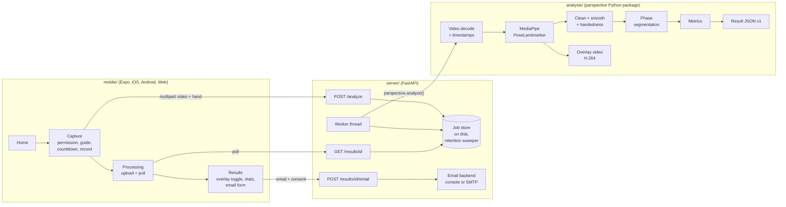

# Parspective Mobile

A single-smartphone version of SAS's **Parspective** putting-analysis system, built by a CSC 4610 capstone team at Tennessee Tech (sponsor: SAS).

You record one putt with a phone and get back a pose-skeleton overlay video plus stroke metrics such as shoulder tilt and tempo. The original Parspective uses a multi-camera rig. This project is a from-scratch build for **one camera, face-on view**. All metric definitions are **provisional** until confirmed with SAS (see [docs/metrics.md](docs/metrics.md) and [docs/open-questions.md](docs/open-questions.md)).

> Status: **Iteration 1 in progress**. Record → skeleton overlay → shoulder tilt + tempo.

## Architecture



| Part | What it is | Docs |
|------|-----------|------|
| [`analysis/`](analysis/) | Pure Python library + CLI. Video in → JSON + overlay out. No web code. | [analysis/README.md](analysis/README.md) |
| [`server/`](server/) | FastAPI service wrapping the analysis core. Runs processing server-side. | _Phase 4_ |
| [`mobile/`](mobile/) | Expo (React Native + TypeScript) client for iOS, Android and web. | _Phase 5_ |
| [`scripts/`](scripts/) | Model download, benchmark. | |
| [`docs/`](docs/) | Metrics, spikes, open questions. | |

## Prerequisites
- Python **3.11** (the version CI tests; 3.10–3.12 are allowed by `pyproject.toml`)
- Node **22 LTS** (only for `mobile/`)
- Docker Desktop (optional, for `docker compose up`)

## Quick start (analysis + server)

```bash
python -m venv .venv
# Windows: .venv\Scripts\activate    macOS/Linux: source .venv/bin/activate
pip install -e "./analysis[dev]" -e "./server[dev]"
python scripts/download_models.py          # MediaPipe pose model -> analysis/models/
```

Analyze a video from the command line:

```bash
python -m parspective analyze samples/putt.mp4 --hand right --out result.json --overlay out.mp4
```

Run the API server:

```bash
cd server
uvicorn app.main:app --reload --host 0.0.0.0 --port 8000
```

_Mobile and Docker instructions are added in Phases 4–5._

## Tests and linting

```bash
ruff check analysis server scripts
black --check analysis server scripts
cd analysis && pytest
cd ../server && pytest
```

CI (`.github/workflows/ci.yml`) runs the same checks on every pull request.

## Privacy
This app records people and can collect email addresses. See [Privacy](#privacy-details) below. The details are finalized in Phase 4.

### Privacy details
- Videos and results are stored only as long as needed. They're deleted after a configurable retention period (default 24 h).
- Email addresses are never logged in plain text and never stored after sending.
- Results are emailed only after the user gives explicit consent.
- Sample videos are git-ignored and must never be committed.

## Team workflow
- Branch from `main` (`feat/...`, `fix/...`). Open a PR. CI must pass. Get at least one review.
- Small, scoped commits with clear messages.
